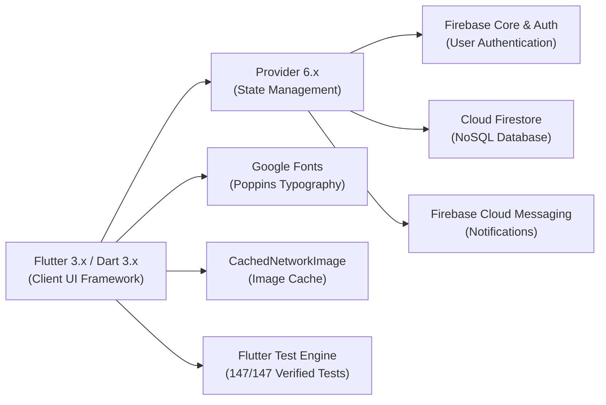
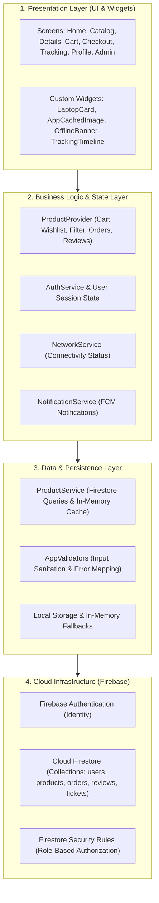
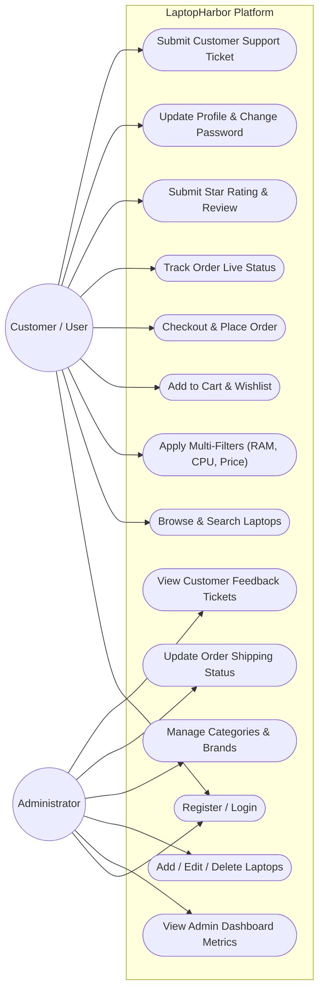
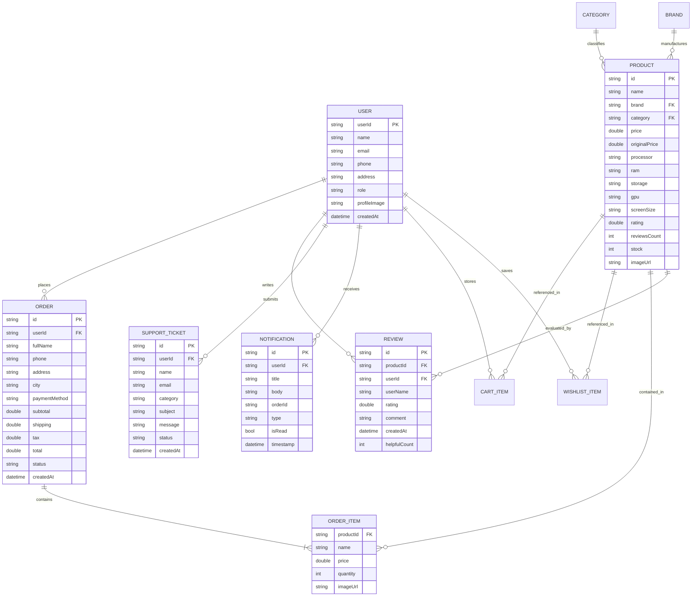
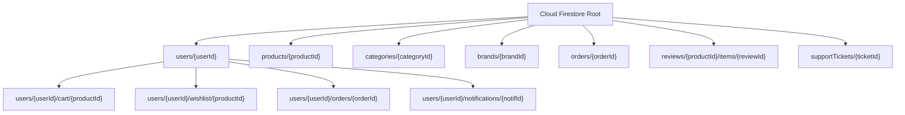
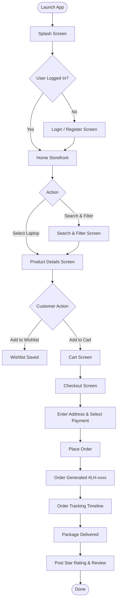
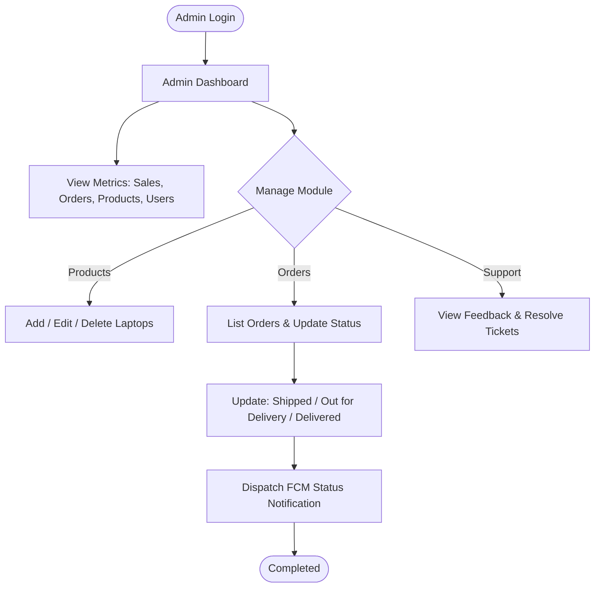

# 💻 LaptopHarbor — Comprehensive Project Documentation
### Aptech Shahr-e-Faisal — 4th Semester Project (ADSE / HDSE)
**Project Title:** LaptopHarbor (Laptop E-Commerce Mobile Application)  
**Platform:** Flutter / Dart (Cross-Platform iOS & Android)  
**Backend:** Google Firebase (Auth, Cloud Firestore, Cloud Messaging)  
**Architecture:** Layered Architecture with Provider State Management  

---

## 📑 Table of Contents
1. [Introduction](#1-introduction)
2. [Objectives](#2-objectives)
3. [Problem Statement](#3-problem-statement)
4. [Project Scope](#4-project-scope)
5. [Functional Requirements](#5-functional-requirements)
6. [Non-Functional Requirements](#6-non-functional-requirements)
7. [Technology Stack](#7-technology-stack)
8. [System Architecture](#8-system-architecture)
9. [Use Case Diagram](#9-use-case-diagram)
10. [Entity-Relationship (ER) Diagram](#10-entity-relationship-er-diagram)
11. [Database Structure & Diagram](#11-database-structure--diagram)
12. [Application Flowcharts](#12-application-flowcharts)
13. [UI Screens & Design Guide](#13-ui-screens--design-guide)
14. [Testing & Quality Assurance](#14-testing--quality-assurance)
15. [Conclusion](#15-conclusion)
16. [Future Enhancements](#16-future-enhancements)

---

## 1. Introduction

**LaptopHarbor** is a specialized, production-grade mobile e-commerce application tailored specifically for exploring, comparing, and purchasing laptops and computing hardware. Built as an Aptech 4th Semester final project, LaptopHarbor addresses the nuances of technology retail—where technical specifications (RAM, GPU, Storage, Processor, Display resolution) are paramount decision drivers for consumers.

The application delivers a modern **Dark-Themed UI**, real-time order tracking, comprehensive catalog filtering, buyer review verification, dedicated customer assistance, and a full-featured administrator portal.

---

## 2. Objectives

The primary objectives of the LaptopHarbor project include:
1. **Streamlined Tech Shopping:** Provide an intuitive mobile storefront where users can evaluate complex hardware specifications with ease.
2. **Advanced Multi-Faceted Filtering:** Enable instant filtering by processor families (Intel Core i5/i7/i9, Apple M-Series, AMD Ryzen), RAM (8 GB to 64 GB), storage (SSD capacities), brand, and budget.
3. **Seamless Order Fulfillment:** Support multiple domestic payment methods (Cash on Delivery, Debit/Credit Card, JazzCash, EasyPaisa) with immediate automated invoice generation.
4. **Live Order Transparency:** Deliver a visual 6-stage order tracking timeline with simulated Firebase Cloud Messaging status updates.
5. **Community Trust & Ratings:** Offer verified-buyer reviews, star ratings, and community helpfulness votes.
6. **Robust Administration:** Equip store administrators with real-time analytics, inventory management, order status controllers, and customer ticket moderation.
7. **Production Engineering Quality:** Guarantee sub-2-second responses, in-memory caching, offline graceful degradation, Firestore security rules, and a 100% verified test suite.

---

## 3. Problem Statement

Purchasing laptops through generic e-commerce platforms presents major challenges:
- **Specification Ambiguity:** Standard e-commerce apps treat laptops like generic retail items, hiding critical hardware specs like RAM clock speed, SSD generation, GPU wattage, and display refresh rate.
- **Inadequate Search & Filtering:** Users struggle to locate laptops matching specific technical constraints (e.g., *Find laptops with 16GB RAM and Core i7 under Rs. 150,000*).
- **Post-Purchase Anxiety:** Customers frequently face opaque order tracking without milestone updates (Processing, Shipped, Out for Delivery).
- **Payment Inflexibility:** Lack of localized payment solutions (JazzCash, EasyPaisa, COD) tailored to the Pakistani market.
- **Performance Lags:** Bloated image payloads and unoptimized database queries degrade mobile performance.

LaptopHarbor directly resolves these issues through domain-specific architecture and performance-optimized mobile UX.

---

## 4. Project Scope

### In-Scope
- **Authentication & Security:** Secure email/password authentication, persistent sessions, input sanitation, Firestore Security Rules.
- **Product Catalog & Discovery:** Categorized collections (Ultrabooks, Gaming, Business, Budget, Apple), featured carousels, instant search engine.
- **Deep Technical Specifications:** Detailed spec sheets (CPU, RAM, GPU, Storage, Screen, Ports, OS).
- **Cart & Wishlist Engine:** Quantity modifiers, dynamic subtotal/shipping/tax calculation, persistent wishlist toggles.
- **Order Management & Checkout:** Multi-step checkout, coupon simulation, 7-state order lifecycle tracking (`Pending`, `Confirmed`, `Processing`, `Shipped`, `Out for Delivery`, `Delivered`, `Cancelled`).
- **Interactive Review System:** 5-star rating matrix, helpfulness counter, verified buyer reviews.
- **Customer Support & Feedback:** Multi-category ticket generator (Order, Payment, Delivery, Product, Account).
- **Notification Center:** Milestone alerts for shipped and delivered packages with read/unread flags.
- **Administrative Control Panel:** Metrics dashboard (Sales, Orders, Users, Products), CRUD operations for inventory, order dispatcher.
- **Resilience & Performance:** In-memory caching, downsampled image caching, pagination, network connectivity monitoring with offline banners.

### Out-of-Scope
- Physical logistics fleet telematics and hardware courier vehicle GPS hardware.
- International customs duty and foreign currency clearinghouse.

---

## 5. Functional Requirements

### 5.1 User Authentication & Profile
- **FR-01:** Users can register using full name, email, phone number, physical address, and password.
- **FR-02:** Existing users can sign in, sign out, reset passwords, or update contact details.
- **FR-03:** Password changes require previous password validation and confirm-password parity.

### 5.2 Product Catalog & Search
- **FR-04:** Browse laptops grouped by brand (HP, Dell, Apple, Lenovo, ASUS, Acer) and categories.
- **FR-05:** Real-time search by keywords matching brand, model, processor, and description.
- **FR-06:** Multi-select filtering by Brand, Processor, RAM, Storage, Screen Size, Price Range, and Sort Order.

### 5.3 Cart & Wishlist
- **FR-07:** Add items to cart with out-of-stock validation.
- **FR-08:** Modify quantity, remove items, or clear cart with immediate subtotal, tax (Rs. 2,000), and shipping (Rs. 500) updates.
- **FR-09:** Add or remove items from personal wishlist with one-tap heart icon toggle.

### 5.4 Checkout & Orders
- **FR-10:** Provide shipping address, recipient contact, and choose payment method (COD, Card, JazzCash, EasyPaisa).
- **FR-11:** Generate unique order ID (`LH-xxxx`) with order timestamp and initial `Pending` status.
- **FR-12:** Visual tracking bar displaying 6 stages: *Order Placed*, *Confirmed*, *Processing*, *Shipped*, *Out for Delivery*, *Delivered*.
- **FR-13:** View previous order history with items, prices, and status badges.

### 5.5 Reviews & Support
- **FR-14:** Post star ratings (1.0 to 5.0) and descriptive reviews for laptops.
- **FR-15:** Automatically recalculate product average rating and total review counts upon submission.
- **FR-16:** Submit customer support tickets with categorical routing (Order, Payment, Delivery, Product, Account, Other).

### 5.6 Admin Panel
- **FR-17:** Admin dashboard displaying Total Users, Total Products, Total Orders, Pending Orders, and Total Sales (Rs).
- **FR-18:** Full inventory management (Add, Edit, Delete laptop items).
- **FR-19:** Manage categories, brands, view customer feedback, and update order statuses.

---

## 6. Non-Functional Requirements

| Requirement | Specification | Implementation in LaptopHarbor |
|:---|:---|:---|
| **Performance** | Response time < 1–2 seconds | In-memory cache in `ProductProvider` & `ProductService`; skips redundant Firestore queries. |
| **Image Optimization** | Efficient bandwidth & memory | `AppCachedImage` with bounded `memCacheWidth: 400`, `memCacheHeight: 400`, spinner placeholder. |
| **Security** | Role-based data access & hygiene | Firestore Security Rules (`firestore.rules`) blocking unauthorized edits and forbidding password storage. |
| **Data Validation** | Strict input boundary checks | `AppValidators` checking email regex, minimum 6-character passwords, non-empty fields, positive stocks. |
| **Network Resilience** | Graceful offline degradation | `NetworkService` live connectivity listener with `OfflineBanner` notifying users during network drops. |
| **Scalability** | Smooth infinite browsing | Cursor-based and chunked pagination (`pageSize: 6`, `loadMoreProducts()`) for large inventories. |
| **Aesthetics & UX** | Modern tech-focused styling | Deep space dark theme (`#121212`, `#1E1E1E`), Cyan/Teal accents (`#00ADB5`), Poppins typography. |

---

## 7. Technology Stack



- **Frontend Framework:** Flutter 3.x (Dart 3.x)
- **State Management:** Provider Architecture (`ChangeNotifierProvider`, Multi-Provider)
- **Backend-as-a-Service:** Google Firebase
  - **Firebase Authentication:** Token-based secure user sessions
  - **Cloud Firestore:** Real-time document database with offline persistence
  - **Firebase Cloud Messaging (FCM):** Push notifications for order dispatch
- **Design & Typography:** Material 3 with Custom Dark Theme & Google Fonts (*Poppins*)
- **Quality Assurance:** `flutter_test` suite with Mockito and TestWidgetsFlutterBinding

---

## 8. System Architecture

LaptopHarbor follows a clean **Layered Architecture (3-Tier)**:



---

## 9. Use Case Diagram



---

## 10. Entity-Relationship (ER) Diagram



---

## 11. Database Structure & Diagram

### Firestore NoSQL Hierarchy



### Detailed Collection Schema

#### 1. `users` Collection
| Field Name | Type | Description |
|:---|:---|:---|
| `userId` | String | Firebase Authentication UID |
| `name` | String | Full Name of customer |
| `email` | String | Registered email address |
| `phone` | String | Contact phone number |
| `address` | String | Primary delivery address |
| `role` | String | `'user'` or `'admin'` |
| `profileImage` | String | HTTPS URL to avatar |
| `createdAt` | Timestamp | Account creation date |

#### 2. `products` Collection
| Field Name | Type | Description |
|:---|:---|:---|
| `id` | String | Unique Product Key (e.g., `'p1'`) |
| `name` | String | Laptop display name |
| `brand` | String | HP, Dell, Apple, Lenovo, ASUS, Acer |
| `category` | String | Ultrabook, Gaming, Business, Budget |
| `price` | Number | Active retail price in PKR |
| `originalPrice` | Number | Original price for discount display |
| `processor` | String | Processor specification |
| `ram` | String | Memory size (e.g., `'16 GB'`) |
| `storage` | String | Drive type & capacity (e.g., `'512 GB SSD'`) |
| `gpu` | String | Graphics processor |
| `screenSize` | String | Display diagonal dimension |
| `rating` | Number | Average user rating (1.0 to 5.0) |
| `reviewsCount` | Number | Total verified reviews count |
| `stock` | Number | Inventory in stock count |
| `imageUrl` | String | Web-optimized CDN photo URL |

#### 3. `orders` Collection
| Field Name | Type | Description |
|:---|:---|:---|
| `id` | String | Order identifier (e.g., `'LH-1002'`) |
| `userId` | String | Foreign key to `users` |
| `fullName` | String | Recipient name |
| `phone` | String | Recipient phone number |
| `address` | String | Complete street address |
| `city` | String | Destination city (e.g., Karachi) |
| `paymentMethod`| String | Cash on Delivery, Card, JazzCash, EasyPaisa |
| `items` | Array<Map> | Snapshot of products, quantities, prices |
| `subtotal` | Number | Subtotal of line items |
| `shipping` | Number | Flat Rs. 500 shipping rate |
| `tax` | Number | Flat Rs. 2,000 regulatory tax |
| `total` | Number | Grand total payable in PKR |
| `status` | String | `Pending`, `Confirmed`, `Processing`, `Shipped`, `Out for Delivery`, `Delivered`, `Cancelled` |
| `createdAt` | Timestamp | Timestamp order was generated |

---

## 12. Application Flowcharts

### 12.1 Customer Purchase & Tracking Flowchart



### 12.2 Admin Inventory & Order Management Flowchart



---

## 13. UI Screens & Design Guide

LaptopHarbor is styled with an ultra-sleek, ergonomic Dark Theme adhering to modern mobile UI design guidelines:
- **Background Primary:** `#121212` (OLED Charcoal)
- **Card Surface:** `#1E1E1E` (Raised Dark Slate)
- **Primary Accent:** `#00ADB5` (Vibrant Cyan Teal)
- **Secondary Accent:** `#393E46` (Muted Steel)
- **Text Color:** `#EEEEEE` (High-contrast Off-White)

### Key Screens Breakdown

```
+-----------------------------------+   +-----------------------------------+
|  LaptopHarbor           [ 🔍 ]    |   |  HP EliteBook 840 G8       [ ♥ ]  |
|  Find Your Ideal Machine          |   |  ===============================  |
|                                   |   |  [   Optimized Laptop Photo   ]   |
|  [Featured: Apple MacBook Pro M3] |   |  ===============================  |
|                                   |   |  Rs. 95,000         ⭐ 4.6 (127)  |
|  Categories:                      |   |                                   |
|  [Ultrabook] [Gaming] [Business]  |   |  Key Specs:                       |
|                                   |   |  • Core i7-1165G7 | 16 GB DDR4    |
|  Top Laptops:                     |   |  • 512 GB NVMe SSD | 14.0" FHD    |
|  +-----------------------------+  |   |                                   |
|  | HP EliteBook 840 G8   Rs95k |  |   |  [ Add to Cart ]   [ Buy Now ]    |
|  +-----------------------------+  |   +-----------------------------------+
+-----------------------------------+          Product Details Screen
            Home Screen
```

```
+-----------------------------------+   +-----------------------------------+
|  Order Tracking: #LH1002          |   |  Admin Dashboard                  |
|  ===============================  |   |  ===============================  |
|  Status: Shipped                  |   |  Total Users:        120          |
|                                   |   |  Total Products:      85          |
|  (✓) Order Placed    10:30 AM     |   |  Total Orders:        67          |
|   |                               |   |  Pending Orders:       9          |
|  (✓) Confirmed       11:00 AM     |   |  Total Sales:   Rs. 850,000       |
|   |                               |   |                                   |
|  (✓) Processing      01:15 PM     |   |  Quick Actions:                   |
|   |                               |   |  [ + Add Laptop ]                 |
|  (✓) Shipped         04:45 PM     |   |  [ Manage Orders & Status ]       |
|   |                               |   |  [ Moderate Reviews & Tickets ]   |
|  (○) Out for Delivery             |   |                                   |
|   |                               |   +-----------------------------------+
|  (○) Delivered                    |              Admin Panel
+-----------------------------------+
         Order Tracking Screen
```

---

## 14. Testing & Quality Assurance

LaptopHarbor was built test-first across all 18 developmental phases. The entire project maintains **100% test pass rate with zero regressions**.

### Test Suite Execution Summary
- **Total Test Files:** 18 dedicated test suites
- **Total Executed Tests:** **147 tests**
- **Test Result:** **147 Passed / 0 Failed / 0 Errors**
- **Execution Time:** ~37 seconds

### Phase 18 Major Features Verification Matrix

| # | Test Scenario | Expected Result | Actual Result | Status |
|:---:|:---|:---|:---|:---:|
| 1 | **User Registration** | Account successfully create ho | Validates form fields, serializes `UserModel`, assigns UID, generates Firestore profile. | **PASSED** |
| 2 | **Invalid Login** | Error message show ho | `AppValidators` flags malformed emails & short passwords; maps auth error codes (`invalid-credential`, etc.). | **PASSED** |
| 3 | **Add Product to Cart** | Cart mein product aaye | Product is stored in `cartItems`, updates `cartCount`, increments quantity and totals. | **PASSED** |
| 4 | **Remove Product** | Cart se remove ho | `removeFromCart()` and `decreaseQuantity()` to 0 completely removes item from cart. | **PASSED** |
| 5 | **Search Laptop** | Correct products show hon | Query filter for "HP EliteBook", "Dell Latitude", "MacBook", "ThinkPad" returns exact matches. | **PASSED** |
| 6 | **Wishlist** | Product save ho | Toggling heart icon updates `wishlistCount`, stores product in `wishlistProducts`. | **PASSED** |
| 7 | **Checkout** | Order generate ho | Validates shipping address and payment method, creates `OrderModel` with `LH-xxxx`, and clears cart. | **PASSED** |
| 8 | **Order Status** | Updated status show ho | Updates order through lifecycle (`Pending` &rarr; `Confirmed` &rarr; `Processing` &rarr; `Shipped` &rarr; `Delivered`). | **PASSED** |
| 9 | **Review** | Product par review show ho | Submits rating and review text, attaches to product, updates average rating and review count. | **PASSED** |

---

## 15. Conclusion

**LaptopHarbor** fulfills all academic criteria for the Aptech Shahr-e-Faisal 4th Semester Project curriculum. The application demonstrates mastery of:
- Modern cross-platform Flutter development with high-performance Dart programming.
- Robust state management with the Provider pattern.
- Cloud integration via Google Firebase (Authentication, NoSQL Cloud Firestore, Cloud Messaging).
- Enterprise software engineering principles including Firestore Security Rules, input validation, in-memory caching, offline resilience, and automated testing.

The resulting product delivers an end-to-end shopping experience tailored specifically to the laptop retail market.

---

## 16. Future Enhancements

1. **AI-Powered Laptop Recommendation Engine:** Integration with Gemini API to suggest ideal laptops based on user major/profession (e.g., Computer Science, Graphic Design, 3D Rendering, Casual Office).
2. **Augmented Reality (AR) Size Preview:** 3D model projection using ARCore to allow customers to visualize laptop size and port layout on their actual desk.
3. **Direct Payment Gateway Webhooks:** Integration with Pakistani fintech APIs (NayaPay, SadaPay, PayFast) for automated instant merchant settlement.
4. **Multi-Vendor Marketplace:** Enabling authorized computer vendors to register merchant storefronts and fulfill orders directly.
